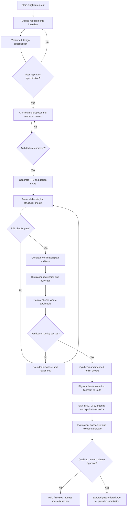

# DEVIN AI FOR VLSI — Product Requirements, System Architecture, and Claude Code Build Prompt

**Document version:** 1.1  
**Prepared:** 23 October 2026

**Revision 1.1 change:** Agentic orchestration and AI-provider/model execution are explicitly decoupled. A project owner can use hosted APIs, local models, self-hosted inference, or a custom third-party endpoint through provider adapters.  
**Product codename:** Devin AI for VLSI  
**Target user:** A non-technical customer who describes the chip they need in plain English  
**Initial domain:** Small digital ASIC blocks, from requirement capture through RTL verification and an open-source RTL-to-GDSII implementation flow  
**Primary implementation approach:** A controlled, auditable agentic workflow with provider-independent AI adapters and deterministic EDA tools—not an unconstrained autonomous coding agent

---

## 0. READ THIS FIRST: THE ENGINEERING REALITY

Build a serious digital-ASIC automation product, but do **not** claim that the first version can design any chip, support every process node, or submit production-ready silicon to every foundry automatically.

### Recommended first target

Start with a small digital block such as a synchronous FIFO, timer/counter, register bank, PWM controller, SPI controller, or UART controller. For an open-source learning/prototype flow, target one supported public PDK first—preferably SKY130 or GF180MCU—after validating the exact PDK variant and the selected flow. Keep the architecture extensible to additional PDKs through adapters.

The phrase “small nm” is ambiguous. In semiconductor terminology, smaller node numbers such as 7 nm, 5 nm, and 3 nm refer to advanced manufacturing processes; they are not the easiest open-source starting point. This first release must use a reproducible, supported public-PDK flow. It must not pretend that a 130 nm/180 nm flow is equivalent to a modern advanced-node production flow.

### Non-negotiable limitations to encode into the software

1. **A generated design is not automatically correct.** Every generated version must pass the checks applicable to it, and the application must display exactly which checks were run and which were not.
2. **Open-source PDK support is not universal foundry sign-off.** Public SKY130 and GF180MCU documentation has described the released PDK data as experimental preview and cautions against assuming production readiness. Before a real tapeout, verify the current PDK release status, license, design rules, device models, required collateral, and foundry/shuttle requirements directly with the relevant provider.
3. **UVM support is version- and feature-dependent.** Recent Verilator documentation reports UVM 2020-3.2 support in Verilator 5.052, with limitations. Do not claim complete compatibility based only on the existence of that support. Run a capability/preflight test against the exact simulator build and the project's UVM feature set. If a test cannot be supported, explain the limitation and permit a compatible external commercial simulator adapter.
4. **RTL-to-GDS is not the whole chip-development lifecycle.** A real chip can also need pad-ring and I/O-cell planning, memory macros, analog/mixed-signal IP, ESD/latch-up strategy, DFT/ATPG, package/bonding/bumps, reliability analysis, silicon test plans, foundry-specific decks, and human sign-off. These are not automatically solved by producing a GDSII file.
5. **No invented constraints.** The system may recommend clock frequency, reset behavior, area targets, interfaces, timing assumptions, or technology settings, but it must mark them as proposals and obtain approval before using them as requirements.
6. **No automatic manufacturing release in the MVP.** The MVP exports a well-documented release candidate package. A qualified human must review it and submit it through the chosen foundry, shuttle, or MPW process. Direct submission may be added only for a specific provider with an explicit, supported API and authorization.
7. **No unbounded agent loops.** All tool execution must be controlled by a state machine, resource limits, timeouts, retry limits, immutable artifacts, and a complete audit trail.
8. **No AI vendor lock-in.** Core VLSI workflow stages, state transitions, verification policy, and EDA adapters must not depend on a specific model/vendor. Any supported API/local endpoint can be configured through adapters, but capabilities must be tested and no-AI API endpoints cannot be integrated without a connector.

The product must be honest about the difference between a successful tool run, a prototype-ready artifact, and a foundry-approved manufacturing release.

---

# PART A — THE PRODUCT

## 1. Product vision

Build a “Devin for digital chip design”: the user describes what they want in plain English; the application turns that request into a reviewable engineering specification, proposes a digital architecture, generates RTL and verification assets, runs tools, diagnoses errors, iterates within controlled limits, implements physical design where supported, evaluates the result, and assembles a traceable release package.

The user should not need to know what RTL, SDC, synthesis, STA, CTS, DRC, LVS, or GDSII mean before starting. The interface must explain these concepts in simple language, while providing detailed engineering artifacts and reports for an expert reviewer.

**Core promise:** “Describe the behavior you need. Devin AI for VLSI will guide the design process, run available engineering checks, show the evidence, and prepare the files for expert review.”

**Do not promise:** “Describe anything and receive guaranteed, production-ready silicon with no engineers required.”

## 2. User persona and experience

The primary user is non-technical. The application must:

- Use plain English, short questions, examples, and diagrams.
- Ask one understandable question at a time in conversational mode.
- Offer “I don’t know—recommend an option” where a choice is technical.
- Explain why information is needed and what happens if it remains unknown.
- Separate confirmed user requirements from AI-proposed assumptions.
- Never silently turn an assumption into a hard requirement.
- Show a “Review and approve specification” step before generating final RTL.
- Translate logs into a simple diagnosis without hiding the original log.
- Let users view/download artifacts but avoid requiring them to edit source code.
- Always preserve access to generated RTL, testbenches, reports, logs, configuration files, and release manifests for an engineer.
- Display an easy-to-understand project status: **Needs information**, **Waiting for approval**, **Running checks**, **Failed**, **Prototype checks passed**, **Release candidate ready for review**, or **Blocked by missing/sign-off-only requirements**.

Example of an acceptable question:
> “Should the chip remember the last 16 values it receives, or should it store a different number? If you are unsure, I can recommend a small starting size and show the trade-offs.”

Example of an unacceptable behavior:
> The AI assumes a clock frequency, reset polarity, I/O voltage, timing exceptions, process corner, or area target and presents the result as if the user provided it.

## 3. Supported MVP scope

### Include in the first release

1. Project creation and requirement gathering through a guided conversation/form.
2. Requirements normalization into a versioned, typed design specification.
3. Architecture proposal with block diagram, interface table, operating assumptions, and open questions.
4. RTL generation for a constrained synthesizable SystemVerilog subset, with Verilog output where requested.
5. RTL lint, parsing/elaboration, compilation, and basic structural checks.
6. Generated directed and randomized tests; simulator-backed regression.
7. Cocotb-based verification for the default MVP path; SystemVerilog testbench support where the selected simulator permits it.
8. Optional formal property checks for supported designs and constructs.
9. Logic synthesis, synthesis statistics, and checks for unsupported constructs/latches/unmapped cells.
10. Physical implementation through one explicitly selected primary flow and a supported public PDK.
11. Static timing analysis against an approved timing constraint set.
12. Applicable DRC/LVS/antenna checks where supported by the chosen PDK and flow.
13. Evaluation summary, requirement-to-test traceability, reproducible logs, artifact history, and downloadable package.
14. Safe repair loop: diagnose, propose a fix, re-run relevant checks, preserve every attempt, stop after configured limits.
15. Human review and explicit release approval gates.

### Explicitly out of scope for the first release

- Arbitrary analog/custom transistor-level design.
- Universal mixed-signal/AMS design and simulation.
- Universal conversion of any model into any hardware design.
- Guaranteed coverage of every SystemVerilog language feature or every UVM methodology feature.
- Guaranteed support for every commercial foundry, node, PDK, IP library, or proprietary sign-off tool.
- Production sign-off without the foundry's required technology files, decks, rules, and process.
- Automatic procurement of IP, foundry reservations, mask orders, or fabrication payments.
- Automatic submission to a foundry without a provider-specific authorized integration and human approval.
- Automatic invention of physical constraints or foundry-specific configuration.
- Autonomous modification of requirements merely to make a failed build pass.

---

# PART B — END-TO-END ENGINEERING WORKFLOW

## 4. Workflow overview

Implement a deterministic, persisted workflow. Each stage has an owner, typed inputs, outputs, pass/fail criteria, resource limits, and a status. AI agents may propose content and fixes; the workflow controller decides what can run next.



The diagram represents the proposed software workflow, not a guarantee that every verification or sign-off stage is available for every PDK.

## 5. Stage 0 — Project setup and capability preflight

Before accepting a design for implementation, create a project workspace and run a toolchain preflight.

Collect or generate:

- Project name, owner, purpose, confidentiality level, and revision.
- Target flow and exact PDK variant.
- Top-module name and selected HDL standard.
- Required tools, versions, container image digests, configuration hashes, and licenses.
- Whether the selected machine has sufficient CPU, RAM, storage, and runtime budget.
- Whether required PDK collateral, standard-cell libraries, timing libraries, DRC/LVS decks, and required IP are available and authorized.
- Whether the selected simulator supports the planned testbench/UVM features.

Preflight must fail clearly if a mandatory input is missing. It must not download or use restricted PDK collateral without the user's authorization and permitted license.

## 6. Stage 1 — Plain-English requirement capture

The AI interview converts user intent into a structured requirements model. Questions should adapt to the requested block, but the model must cover the following fields when relevant.

### Functional behavior

- What job should the chip/block perform?
- Inputs and outputs, including expected ranges and units.
- State the block must remember.
- Behavior for normal operation, invalid input, overflow/underflow, conflicts, timeout, or other edge cases.
- Reset behavior and startup state.
- Interface/protocol (for example, simple valid/ready, UART, SPI, I2C, or a memory-mapped bus) only when required.

### Timing and operating requirements

- Clock source(s), target frequency, generated clocks, and clock-domain boundaries.
- Latency/throughput requirements and relevant timing assumptions.
- Input/output timing constraints when known.
- Reset timing and synchrony requirements.
- Operating corners and environmental conditions only where the chosen flow can represent them.

### Physical and process requirements

- Target process/PDK and approved version.
- Required I/O cells, pad ring, voltage domains, and core/periphery assumptions.
- Desired area, power, performance, and trade-off priorities.
- Required macro memories or third-party IP and their approved views.
- Required output database and file formats.

### Quality and delivery requirements

- Expected test scenarios.
- Required assertions and coverage targets.
- Formal verification needs.
- DFT/scan requirements.
- Required reports, source formats, documentation, and review milestones.
- Prototype/learning target versus a real commercial manufacturing target.

### Specification rules

Every field must carry:

- `value`
- `unit` where applicable
- `source`: user-confirmed / imported-document / AI-proposed / tool-derived
- `confidence` or uncertainty where appropriate
- `status`: confirmed / proposed / unknown / blocked
- `rationale`
- `revision`

The system must maintain an `open_questions` list. A critical unknown—such as target PDK, clock/reset behavior, interface contract, or required operating frequency—must block affected downstream stages until resolved or explicitly accepted as an assumption for a non-production experiment.

## 7. Stage 2 — Generate an engineering design specification

Create `spec/design_spec.yaml` (and a human-readable HTML/PDF view) as the canonical versioned contract.

Suggested top-level schema:

```yaml
schema_version: "1.0"
project:
  name: "example_fifo"
  revision: 1
  intended_use: "prototype"
  top_module: "sync_fifo"
  hdl: "SystemVerilog"
target:
  flow: "openroad-flow-scripts"
  pdk: "UNCONFIRMED"
  pdk_variant: "UNCONFIRMED"
requirements:
  - id: "REQ-FUNC-001"
    title: "Preserve accepted data order"
    statement: "Accepted items are read in the same order they were written."
    priority: "must"
    status: "proposed"
    verification_method: "simulation_and_formal_if_supported"
interfaces: []
clocks: []
resets: []
constraints:
  timing: "UNCONFIRMED"
  area: "UNCONFIRMED"
  power: "UNCONFIRMED"
assumptions: []
open_questions: []
approvals: []
```

The example is a schema illustration, not a valid final design specification. The product must validate this YAML/JSON against a real schema and prevent placeholder values from accidentally becoming valid physical-design inputs.

The specification generator must also produce:

- Requirements-to-design mapping.
- Interface/pin table.
- Clock/reset table.
- State machine and behavior description.
- Out-of-scope behavior.
- Assumptions and risks.
- Acceptance criteria that can be tested.

## 8. Stage 3 — Architecture proposal

Before generating RTL, create and show:

- Block diagram and module boundaries.
- Interface descriptions and handshake rules.
- Data width/depth/parameter recommendations.
- State machine, buffering, counters, and arbitration logic where relevant.
- Clock/reset-domain assumptions.
- Timing and area risk analysis.
- Proposed reusable modules and dependencies.
- Verification strategy.
- A list of decisions requiring user/expert approval.

The AI must distinguish architecture options from factual requirements. Record the reason for the selected option and preserve alternatives.

## 9. Stage 4 — RTL generation

Generate clean, synthesizable HDL under `rtl/`.

Rules:

1. Use a documented coding style and a conservative synthesis-compatible subset.
2. Separate synthesizable design code from testbench-only code.
3. Use clear module names, explicit widths, intentional signedness, parameters/localparams, and reset behavior.
4. Avoid simulation-only constructs in synthesizable RTL.
5. Avoid latches unless they are explicitly intended, supported by the flow, and approved.
6. Do not rely on `X`/`Z` behavior or simulator quirks to define functional behavior.
7. Generate comments that explain design intent, not comments that merely repeat the code.
8. Generate an interface contract and a short design rationale.
9. Record the model/provider/version and prompt/build configuration used to generate or change RTL.
10. Hash each source revision and never overwrite a previously tested revision.

For important blocks, use independent review passes: one agent generates the candidate; another checks it against the approved requirements and identifies potential defects. Reviewer output is advisory until verified by the tools.

### Required RTL files

Depending on project type, create:

- `rtl/<top>.sv` or `.v`
- Supporting RTL modules/packages/interfaces.
- `rtl/filelist.f`
- A documented top-module and parameter list.
- Lint configuration and waivers (each waiver must have a reason and owner/reviewer).

## 10. Stage 5 — Parse, elaborate, and lint

Run, where suitable:

- Verilator lint.
- A SystemVerilog parser/elaborator such as slang or Surelog/UHDM when appropriate and installed.
- The synthesis frontend's elaboration/check commands.
- Port, width, undriven-signal, multiple-driver, unreachable-state, latch, and unsupported-construct checks.

Do not treat Yosys parsing as the only syntax check: Yosys documents its SystemVerilog support as a subset and recommends dedicated simulation/linting tools for syntax checking. Tool capability and warning policies must be versioned.

Classify findings as:

- Error: blocks all downstream execution.
- Warning: blocks or permits a stage depending on a published policy.
- Informational: preserved in report.
- Approved waiver: requires rationale and review trace.

The AI repair loop may fix a warning only if doing so does not alter approved functionality; otherwise it must request approval.

## 11. Stage 6 — Build a verification plan and test assets

Create a verification plan before claiming a design is verified.

Required artifacts:

- Requirement-to-test traceability matrix.
- Directed tests for required behavior and edge cases.
- Randomized tests where suitable.
- Reference model/scoreboard where suitable.
- Assertions and protocol checks where supported.
- Regression configuration and deterministic random seeds.
- Functional/code coverage reports only for coverage types actually collected.
- Failed-test waveform paths and minimized failure details where possible.

### Simulator strategy

**Default open-source MVP path:** Verilator + cocotb for Python-driven verification, with SystemVerilog testbench support added where compatible. Icarus Verilog may be offered as a secondary simulator for compatible, simpler designs.

**UVM:** Provide a simulator adapter interface. Preflight the precise simulator release and UVM version/feature set. Verilator 5.052 documentation, dated September 2026, reports UVM 2020-3.2 support with limitations; therefore, the product must run a compatibility suite and show any unsupported feature. Do not advertise “complete UVM support” without testing and documenting the supported subset. Allow an authorized commercial simulator adapter for use cases that exceed the open-source path.

### Coverage policy

Do not report “100% verification” as a blanket claim. Report precise, scoped measurements such as:

- Number of requirements linked to tests.
- Number of tests passed/failed/skipped.
- Coverage metrics actually enabled and collected.
- Assertions evaluated and their results.
- Formal properties proved, disproved, or inconclusive.
- Unverified requirements and known gaps.

## 12. Stage 7 — Simulation and bounded debugging

Run the regression in a clean, reproducible execution environment.

On failure:

1. Capture the tool's exit code, full log, command, environment, runtime, seed, source revision, and generated waveforms.
2. Group failures by likely root cause without hiding individual failures.
3. Ask the AI for a minimal diagnosis and proposed change.
4. Compare the proposed fix against the accepted design specification.
5. Apply the fix as a new source revision.
6. Re-run lint and the failed tests, then rerun the full regression at defined checkpoints.
7. Preserve the failed and successful attempts.
8. Stop after a configurable small number of repair rounds (default: 3); mark the run blocked and explain what human decision is needed.

The AI must not lower test expectations, delete failing tests, waive errors, change a requirement, or disable assertions just to obtain a green result. Such changes require explicit authorization and an audit entry.

## 13. Stage 8 — Formal verification where applicable

Use Yosys/SymbiYosys for formal checks supported by the selected RTL subset, such as bounded safety properties, assertions, and selected liveness properties. Use equivalence-checking tools when available and appropriate.

Possible properties for a FIFO include:

- A read never returns an item that was not previously accepted for writing, within the documented semantics.
- Item ordering is preserved.
- Occupancy remains within the legal range.
- Full/empty flags are consistent with the state model.
- Reset establishes the documented initial state.

These are examples only; the correct properties depend on the interface contract and simultaneous read/write semantics.

Every formal report must identify assumptions, constraints, proof engine, depth/limits, source hash, and result. Use distinct statuses: `PROVED`, `COUNTEREXAMPLE_FOUND`, `BOUNDED_PASS_ONLY`, `UNKNOWN`, `TIMEOUT`, and `NOT_RUN`. Never label a bounded pass as an unbounded proof.

## 14. Stage 9 — Synthesis and netlist evaluation

Run synthesis using Yosys or the selected flow's supported synthesis step.

Record:

- Synthesis success/failure.
- Mapped and unmapped cell counts where available.
- Sequential/combinational counts.
- Latch and inferred-memory reports.
- Area estimate and its basis.
- Warnings and unsupported cells/constructs.
- Netlist and synthesis log hashes.

Compare the synthesized netlist and reports against the approved design targets. Area and power estimates are estimates, not final silicon measurements. Do not report power as accurate without describing libraries, activity assumptions, corner, voltage, temperature, and analysis method.

## 15. Stage 10 — Constraints and physical implementation

Use one primary RTL-to-GDS flow for the MVP to avoid maintaining two incomplete paths. Recommended initial option: OpenROAD Flow Scripts (ORFS), with an optional OpenLane 2 adapter added later only after the primary pipeline passes acceptance tests.

For each job, store the exact:

- PDK and fully qualified PDK variant.
- Standard-cell library and corner.
- `LIB`/Liberty and LEF views.
- RTL filelist and top module.
- SDC constraints.
- Flow configuration and tool versions.
- Macro and I/O assumptions.
- Floorplan dimensions/target utilization and relevant routing settings.
- Power/ground net names and applicable PDN configuration.

### Physical-design stages

The orchestration should explicitly model the stages used by the selected flow. Typical stages include:

1. Technology/platform preflight.
2. Synthesis.
3. Floorplan initialization and die/core definition.
4. I/O planning and placement, when applicable.
5. Tapcell/welltie insertion where required.
6. Power delivery network (PDN) generation.
7. Macro placement if the design has macros.
8. Global placement, timing-driven optimization, and detailed placement.
9. Clock-tree synthesis (CTS).
10. Global routing and detailed routing.
11. Antenna checks and diode insertion where supported.
12. Parasitic extraction.
13. Post-route static timing analysis (STA).
14. Metal fill/finishing where required by the flow.
15. Applicable DRC/LVS and other physical checks.
16. GDSII merge/export and final artifact manifest.

Do not hard-code every stage into one giant Python function. Each stage must be a typed workflow task with its own inputs/outputs, logs, timeouts, retry behavior, tool version, and machine-readable result.

### Timing constraints: safety rule

An SDC file is not a decoration. Clock period, input/output delays, uncertainty, generated clocks, false paths, multicycle paths, and asynchronous exceptions have real effects on optimization and analysis.

The system can propose an SDC draft and explain it, but critical timing assumptions must be confirmed by the user or a qualified engineer. Missing constraints must produce `TIMING_CONSTRAINTS_INCOMPLETE`, not a green “timing passed” badge.

### Physical checks

For the chosen PDK and flow, run all applicable supported checks and record their limitations:

- DRC: design-rule violations against the selected rule deck.
- LVS: consistency of the extracted layout netlist against the reference netlist.
- Antenna checks.
- STA: setup/hold and other applicable timing checks supported by the flow.
- Connectivity, power-grid, and missing/unconnected pin checks when available.

The application must show which DRC decks and LVS/extraction decks were used, whether results are complete, and what checks were unavailable. A DRC/LVS pass using a public prototype deck must not be relabeled as foundry sign-off.

## 16. Stage 11 — DFT and manufacturing test readiness

Treat design-for-test as a separate capability with its own acceptance tests. Explore OpenROAD's DFT module where suitable, but do not assume that automated scan insertion means the design is production-test-ready.

The product must track whether the design requires:

- Scan insertion and scan-chain planning.
- ATPG pattern generation and fault coverage.
- Memory BIST/logic BIST, if applicable.
- JTAG/boundary scan where required.
- Test modes, test clocks/resets, and test access constraints.
- Test coverage reports from the relevant authorized tools.

If the MVP cannot generate and validate a required item, report it as a release blocker or an explicitly accepted missing deliverable—not as complete.

## 17. Stage 12 — Evaluation and engineering report

Generate two reports from the same machine-readable evidence.

### A. Plain-English report for the user

Include:

- What was built and how it is intended to behave.
- What was tested.
- What passed and failed.
- Estimated area/timing results where supported.
- Important assumptions and limitations.
- Any remaining blockers.
- Whether the result is a learning artifact, an open-PDK prototype result, or a release candidate awaiting qualified review.
- What the next safe action is.

### B. Engineering report

Include:

- Design revision and source checksums.
- Requirement-to-test traceability.
- Toolchain versions and execution environment.
- Lint/elaboration reports.
- Simulation summaries, tests, seeds, and coverage.
- Formal results, assumptions, and proof limits.
- Synthesis/netlist reports.
- Physical-design logs, metrics, and stage outcomes.
- STA reports and timing constraints.
- DRC/LVS/antenna reports and deck versions.
- Waivers, unresolved issues, and unavailable checks.
- Artifact manifest, hashes, and release approval signatures.

Use evidence-derived metrics; never use an LLM's unsupported estimate as an authoritative tool result.

## 18. Stage 13 — Release package and foundry handoff

Create a release candidate package only after the required checks for the configured release policy have passed. Never silently skip a required check.

Possible deliverables, depending on the selected flow and the recipient's documented requirements:

- Final GDSII or other explicitly requested layout database.
- DEF and/or OASIS when specifically required.
- Final logical netlist.
- SDC and timing reports.
- LEF/abstract views when applicable.
- Extracted parasitics (SPEF) and relevant reports.
- RTL source and filelists, subject to licensing/IP policy.
- PDK/flow configuration references and tool versions.
- DRC/LVS/antenna reports, waivers, and deck versions.
- DFT/ATPG outputs and reports where required.
- Integration notes, pin list, clocks/resets, power intent, and known issues.
- Build manifest with SHA-256 checksums.

**Do not assume every foundry wants every file in this list.** The selected foundry, shuttle, or MPW provider's current tapeout checklist is authoritative. Create a provider-specific checklist adapter; mark every item as required / optional / not applicable / missing. Never invent submission endpoints, credentials, naming rules, or file formats.

The release UI must:

- Clearly distinguish “package created” from “submitted” and “accepted by foundry.”
- Require an authorized human to sign off the release candidate.
- Record the approver, time, exact source/configuration hashes, and acceptance of open issues.
- Export a manifest and downloadable archive.
- Refuse automatic submission if provider requirements, authorization, or mandatory sign-off evidence are missing.

---

# PART C — TOOLCHAIN AND COMPATIBILITY STRATEGY

## 19. Initial tool recommendations

Treat every tool as an adapter with a declared version and capability profile. Use a pinned, tested container image for repeatability. Do not run arbitrary untrusted scripts directly on the application server.

| Workflow job | First-choice tool(s) | Role and limitations |
|---|---|---|
| HDL lint / compilation checks | Verilator | Lint and simulation; language/UVM support depends on exact release and features. |
| Additional SystemVerilog parsing/elaboration | slang or Surelog/UHDM where suitable | Useful for frontend checks and ecosystem integrations; it is not by itself a complete simulator or sign-off flow. |
| Python-driven RTL verification | cocotb + compatible simulator | Test drivers, scoreboards, test runners, and regressions. |
| Simpler alternative simulation | Icarus Verilog where compatible | Useful for supported Verilog/SystemVerilog subsets; preflight required. |
| Logic synthesis | Yosys | Open-source synthesis; SystemVerilog support is a subset, so lint/elaboration are separate stages. |
| Formal-property verification | SymbiYosys + Yosys + supported solver | Formal proofs for supported models/constructs; record bounded vs unbounded results. |
| RTL-to-GDS physical implementation | OpenROAD Flow Scripts (primary MVP flow) | Synthesis/physical implementation, subject to platform/P DK compatibility and configuration. |
| Alternative flow (later) | OpenLane 2 | Add after MVP acceptance; avoid parallel duplicated flows during initial development. |
| Static timing analysis | OpenSTA, commonly integrated in physical flow | Requires correct netlist, libraries, parasitics, and constraints. |
| Layout viewing / some physical checks | KLayout | Capabilities depend on rule decks and selected PDK. |
| Additional layout checking/extraction | Magic and Netgen where appropriate | PDK- and deck-dependent; no blanket equivalence to commercial sign-off. |
| Workflow glue / reports | Python | Run tools, parse structured reports, normalize metrics, build manifests. |
| Application UI | Next.js + TypeScript | Guided user journey and review dashboards. |
| API / orchestration | FastAPI + Python | Project API, workflow controller, policy gates, tool adapters. |
| Database | PostgreSQL | Durable state, requirements, revisions, results, approvals, audit trail. |
| Job queue | Redis + a mature Python worker queue | Background jobs and progress events; preserve state in PostgreSQL, not only in queue memory. |
| Artifact storage | Local development volume; S3-compatible object storage in deployment | Source files, logs, waveforms, reports, and output archives. |
| Execution isolation | Docker containers on Linux | Per-job toolchain sandbox with quotas, timeouts, mounts, and restricted network. |

### Important compatibility design

Create a `ToolAdapter` interface with methods such as:

- `probe_capabilities()`
- `validate_inputs()`
- `build_command()`
- `execute()`
- `parse_results()`
- `classify_exit_status()`
- `collect_artifacts()`
- `tool_version()`

Do not use the language model to decide whether a tool passed. The adapter must use exit codes, structured reports, configured policies, and explicit artifact presence to classify outcomes.

Tool version pinning should be documented and repeatable. A newer tool version may only become the default after the project's test suite passes against it.

## 20. Open-source toolchain reference links

Use official documentation as the initial sources of truth; recheck current release notes and licenses during implementation.

- OpenROAD Flow Scripts: https://openroad-flow-scripts.readthedocs.io/en/latest/mainREADME.html
- OpenROAD Flow Scripts user guide: https://openroad-flow-scripts.readthedocs.io/en/latest/user/UserGuide.html
- OpenLane 2: https://openlane2.readthedocs.io/en/latest/
- OpenLane 2 PDK configuration: https://openlane2.readthedocs.io/en/latest/usage/about_pdks.html
- Yosys Verilog/SystemVerilog notes: https://yosyshq.readthedocs.io/projects/yosys/en/latest/using_yosys/verilog.html
- Verilator language support: https://verilator.org/guide/latest/languages.html
- Verilator release notes: https://verilator.org/guide/latest/changes.html
- cocotb: https://docs.cocotb.org/
- SymbiYosys: https://symbiyosys.readthedocs.io/en/latest/
- OpenSTA: https://opensta.readthedocs.io/en/latest/
- KLayout LVS overview: https://www.klayout.de/doc/manual/lvs_overview.html
- SKY130 PDK status: https://skywater-pdk.readthedocs.io/en/main/status.html
- GF180MCU PDK repository/status: https://github.com/google/gf180mcu-pdk
- OpenROAD DFT documentation: https://openroad.readthedocs.io/en/latest/main/src/dft/README.html

These links are research starting points, not an assurance that a given project is manufacturable. Validate licenses, exact tool versions, PDK variants, foundry collateral, and process status before use.

---

# PART D — APPLICATION ARCHITECTURE

## 21. Architecture principles

1. **Workflow first, agents second.** Use an explicit state machine or persisted DAG. Agents never bypass gates.
2. **All evidence is traceable.** Every report links to source revision, tool version, configuration, logs, and checksums.
3. **Immutable revisions.** Generated RTL and test assets are never silently overwritten.
4. **Policy-enforced execution.** LLM output is data; it does not get unrestricted shell access.
5. **Reproducibility.** Pin container images, tool versions, inputs, configs, random seeds, and environment details.
6. **Provider neutrality.** AI provider/model/runtime, simulator, flow, PDK, and artifact storage are independently replaceable adapters. The workflow domain model must not import a provider-specific SDK.
7. **Honest uncertainty.** Mark every result as verified, estimated, unknown, unsupported, waived, or not run.
8. **Small MVP.** Implement one complete golden path before building broad plug-in support.

## 22. Recommended software stack

- **Frontend:** Next.js, TypeScript, accessible component system, diagram viewer, artifact browser, live job status.
- **Backend API:** FastAPI with typed request/response models and OpenAPI documentation.
- **Orchestration:** Python workflow state machine with persisted task states; queue slow jobs to workers.
- **Database:** PostgreSQL for projects, requirement versions, workflow runs, tool executions, findings, approvals, and audit events.
- **Queue/events:** Redis plus a job worker framework; use server-sent events or WebSockets for progress events.
- **Artifact storage:** local filesystem in development; S3-compatible storage in production. Database stores metadata and checksums, not large waveforms.
- **EDA workers:** Linux Docker containers, each with limited CPU/RAM/disk/time, no privileged mode, read-only tool images, project-specific input/output mounts, and restricted network access.
- **AI access:** provider-neutral `AIProvider` contract, provider/model registry, capability preflight, and an internal model gateway. Support custom OpenAI-compatible endpoints and local model servers early, then add native provider adapters. Keep provider-specific logic out of workflow and agent code. Never hardcode a model name, endpoint, or credential.
- **Authentication:** local development authentication first; use established authentication/OIDC in shared deployment. Enforce project-level access checks.
- **Deployment:** Docker Compose for local development; separate EDA worker image from the web/API image. Kubernetes is not required for the MVP.

Do not require a GPU for EDA jobs. AI inference may use a remote API or optional local model. EDA workload is primarily governed by CPU, RAM, disk, and runtime; GPU selection must not be presented as a requirement for synthesis or place-and-route.

## 23. Logical components

```text
Browser UI
  └── API / Auth / Project Service
       ├── Requirements & Specification Service
       ├── AI Model Gateway / Provider Registry
       │    ├── OpenAI-Compatible Endpoint Adapter
       │    ├── Native Provider Adapters
       │    ├── Local / Self-Hosted Runtime Adapters
       │    ├── Optional LiteLLM Gateway Adapter
       │    └── Capability Registry, Routing and Budget Policies
       ├── Agent Runtime (bounded task agents)
       ├── Architecture / RTL / Verification Assistants
       ├── Workflow Controller (persistent state machine)
       ├── Policy & Approval Gate
       ├── Tool Adapter Registry
       │    ├── Lint/Elaboration Adapter
       │    ├── Simulation Adapter
       │    ├── Formal Adapter
       │    ├── Synthesis Adapter
       │    ├── Physical Design Adapter
       │    └── Sign-off / Packaging Adapter
       ├── Job Queue & Isolated Linux EDA Workers
       ├── Report & Metrics Service
       ├── Artifact Store
       └── PostgreSQL + Audit Log
```

## 23A. AI-provider-agnostic and model-independent architecture (mandatory)

**Product requirement:** The VLSI workflow must not be tied to Claude, OpenAI, Gemini, a single cloud vendor, a single local runtime, or a particular agent framework. An authorized user can configure the model/provider for the whole project and override it for individual agent roles. The application orchestrates the work; the selected AI is a replaceable reasoning/code-generation service.

### Important boundary: “any AI” means any reachable supported interface—not every chat subscription

The product cannot automatically call a model that exposes no API, no supported local endpoint, and no permitted integration. A consumer chat subscription, website session, or coding-agent subscription is not automatically usable as an application API. The UI must explain this and offer either a supported API connection, a local inference endpoint, or a provider adapter/plugin. Do not scrape consumer UIs or bypass provider terms.

### Required connection types

1. **OpenAI-compatible API endpoint:** user supplies the base URL, model ID, authentication mode/secret, and protocol profile. This covers many hosted gateways and self-hosted inference servers, but compatibility can be partial; it is not proof that every endpoint supports the same parameters, structured outputs, tool calling, or streaming.
2. **Local model runtime:** the user supplies a reachable local or private-network inference endpoint, for example a runtime that exposes an OpenAI-compatible API. Local inference must work without a paid cloud-model account if the user has installed and provisioned a suitable model/runtime.
3. **Native provider adapter:** use a dedicated implementation where the provider has a materially different API or features that cannot be represented reliably through the common protocol.
4. **Custom provider plugin:** an administrator or developer can add a signed/versioned adapter conforming to the documented interface without editing the core workflow engine.
5. **Optional AI gateway:** support an optional self-hosted gateway such as LiteLLM as one configurable upstream. It must not be the only path, a required SaaS dependency, or a hard-coded assumption. The application must be usable without this gateway.
6. **Test/mock provider:** deterministic provider for unit tests, UI demos, offline development, and CI. The UI must visibly label responses produced by a mock provider.

### Mandatory internal abstraction

Implement an internal `AIProvider` interface and normalized `ModelRequest` / `ModelResponse` structures. Do not let agent code call vendor SDKs directly.

Suggested interface (adapt details to the chosen libraries, but preserve the separation):

```python
class AIProvider(Protocol):
    async def probe(self) -> ProviderHealth: ...
    async def list_models(self) -> list[ModelDescriptor]: ...
    async def get_capabilities(self, model_id: str) -> ModelCapabilities: ...
    async def generate(self, request: ModelRequest) -> ModelResponse: ...
    async def close(self) -> None: ...
```

The normalized request should include: model ID, system/developer/user messages, optional approved tool definitions, desired output schema, temperature/sampling options where supported, max output tokens, timeout, cancellation signal, and task metadata. The normalized response should include: text/content blocks, validated structured output when available, normalized tool-call proposals, finish/stop reason, usage if provided, provider/model ID, latency, request ID if provided, warnings, and errors. Do not invent usage, cost, latency, or token values when the provider does not return them.

### Provider and model registry

Store provider connection metadata separately from model profiles:

- `provider_id`, display name, adapter type, endpoint/base URL, protocol version/profile, enabled/disabled state, credential secret reference, owner/scope, data-handling classification, and created/updated timestamps.
- `model_id`, provider ID, model name as supplied by the endpoint, context-window size only when verified, output-token limit only when verified, supported capabilities, known limitations, and last successful probe time.
- `ModelCapabilities`: text input/output, image input, JSON/schema-constrained output, tool/function calling, streaming, cancellation, usage reporting, batch mode, and other required features. Each feature must be `verified`, `unsupported`, or `unknown`, not merely assumed from the model's marketing name.
- `ModelPolicyProfile`: allowed roles/tasks, privacy tier, data egress policy, per-run/token/cost budget if available, latency preference, retry policy, model allowlist, and fallback policy.

Provider discovery may be imperfect. Manual model entry must be allowed when model-list endpoints are missing. A model name entered by the user is not proof that the model supports every feature.

### Capability preflight and conformance tests

Before a model can be selected for a task, run a small optional diagnostic suite and show the results. Check only what is safe and necessary:

1. Connection/authentication and bounded health probe.
2. Simple text generation.
3. Structured output or JSON-schema conformance (if required for that task).
4. Tool-call proposal and argument parsing (if required by the selected agent runtime).
5. Streaming and cancellation (if enabled in the UI/runtime).
6. Context-limit behavior, timeout handling, retry/backoff, and malformed-response handling.
7. Model identifier validity and reported usage availability.

Never infer a pass from HTTP 200 alone. Validate the response against the internal schema. Do not send proprietary RTL, PDK data, or customer documents in a connection test. Show precisely which tests were run.

### Example provider configuration (illustrative; never store real secrets here)

Keep user-facing setup simple while persisting normalized, validated configuration. Store the secret in an environment variable or secret manager and persist only its reference.

```yaml
schema_version: "1.0"
project_ai_policy:
  data_egress: "local_only"  # local_only | approved_providers_only | user_authorized_remote
  default_model_profile: "local-coder"
  allow_automatic_remote_fallback: false
providers:
  - provider_id: "local-openai-compatible"
    adapter: "openai_compatible"
    display_name: "My local model"
    endpoint_env: "DEVIN_LOCAL_LLM_BASE_URL"
    api_key_env: "DEVIN_LOCAL_LLM_API_KEY"  # may be unused by local server
    enabled: true
models:
  - profile_id: "local-coder"
    provider_id: "local-openai-compatible"
    model_id: "USER_CONFIGURED_MODEL_ID"
    required_capabilities: ["text", "structured_output"]
    allowed_roles: ["requirements_analyst", "architecture_designer", "rtl_engineer", "failure_analyst"]
agent_routing:
  requirements_analyst: "local-coder"
  architecture_designer: "local-coder"
  rtl_engineer: "local-coder"
  verification_engineer: "local-coder"
  rtl_reviewer: "local-coder"
```

The UI should expose these settings as a guided connection form, not require a non-technical user to edit YAML. Never hard-code an assumed model ID or assume a local server's endpoint/port. Generate `.env.example` with placeholders only.

### Local runtime connection topology

The phrase “local model” depends on where the backend runs:

- **Single-machine/local deployment:** application API and inference runtime may run on the same machine or in a known Docker network. Document the appropriate container-to-host address; `localhost` inside a container normally means that container, not the user's host machine.
- **Hosted application with model on the user's laptop:** the hosted backend cannot call the laptop's `localhost` directly. Provide a secure device connector/agent or an explicitly configured, authenticated private-network route. Do not tell users to expose an unauthenticated inference server directly to the public internet.
- **Self-hosted/on-prem server:** accept a configured private endpoint or gateway subject to administrator allowlists, authentication, TLS where applicable, network controls, and provider health checks.

The backend, not browser-side JavaScript, should normally hold provider credentials and invoke the model. Validate user-entered URLs to reduce SSRF risk. Support private/local targets only through an explicit local/private connection mode; disallow cloud metadata endpoints and unsafe redirects, re-check resolved destinations, restrict protocols to approved HTTP(S), and never allow model prompts to choose or rewrite provider endpoints.

### Agentic orchestration independent of model provider

Use an `AgentRuntime` that executes typed tasks via the same workflow controller. Each agent role is a task profile, not a vendor-specific implementation. Example profiles:

- `requirements_analyst`
- `architecture_designer`
- `rtl_engineer`
- `verification_engineer`
- `rtl_reviewer`
- `failure_analyst`
- `physical_design_analyst`
- `release_auditor`
- `plain_language_reporter`

Each profile defines its goal, allowed inputs, output schema, permitted tool IDs, model capability requirements, token/runtime budget, retry policy, and approval boundary. Users can assign different models to different roles, for example one local model for confidential RTL review and a hosted model for public documentation summarization. Do not require all agents to use the same vendor or even the same API protocol.

**The orchestrator remains deterministic and provider-independent.** A provider may propose a tool call; the agent runtime validates the tool name, arguments, role permissions, project permissions, current workflow state, and approval requirements before invoking it. EDA commands are launched only through approved `ToolAdapter` commands in isolated workers. The model never receives unrestricted shell, database, network, secrets, or release privileges.

### Model routing and fallback rules

- Allow a project-wide default plus per-role overrides.
- Allow per-task routing only through explicit policy rules, such as privacy tier, model capability, availability, budget, or latency. Do not silently reroute proprietary project inputs to a third-party service.
- Before fallback, verify that the fallback model satisfies the task's required capabilities and data policy. Record every route and reason.
- If the primary model fails, the application may retry or switch providers only when policy explicitly allows it. Otherwise mark the task `BLOCKED_AI_PROVIDER` and explain how the user can proceed.
- A fallback response is a new proposal, not a continuation that can inherit prior validation blindly. Validate its schema and re-run affected deterministic checks.
- Never assume two models produce equivalent results. Model switching must preserve the source of each artifact and rerun affected validation stages.
- Do not automatically send the same proprietary content to several providers for “consensus.” Multi-model review is optional, budgeted, privacy-gated, and auditable.
- Never use model self-reported confidence as evidence that RTL is correct. Simulator/formal/synthesis/physical-tool results remain authoritative for their respective checks.

### Local versus remote data policy

For every connection, show a human-readable label: `local/private endpoint`, `self-hosted gateway`, or `third-party hosted API`. The user must be able to set a policy per project:

- `local_only`: no project content may be sent to a third-party inference provider;
- `approved_providers_only`: only explicitly allowed providers may receive project content;
- `user_authorized_remote`: remote providers are allowed after a clear disclosure/approval.

A failed connection must never cause silent remote fallback when `local_only` is active. Log the provider ID and data-policy decision, but never log credentials or sensitive raw request content unless an explicit, restricted debug setting allows it.

### Provider-neutrality acceptance rule

The same workflow integration tests must run against (a) the deterministic mock provider, (b) one configurable OpenAI-compatible test endpoint, and (c) at least one local-runtime configuration during the MVP. Add native providers incrementally. Swapping provider/model must not require changes to requirements schemas, agent prompts' control flow, EDA adapters, workflow-state transitions, database entities, or release policy.

## 24. AI agent roles (bounded, not independent executives)

Use separate role prompts/tools for clarity, but orchestrate them through the same controlled workflow:

1. **Requirements Analyst:** turns natural language into candidate requirements and open questions; cannot approve its own assumptions.
2. **Architecture Designer:** proposes module structure, interfaces, state machines, and trade-offs; cannot silently modify the specification.
3. **RTL Engineer:** generates or minimally patches source files within an approved revision.
4. **Verification Engineer:** independently derives tests and assertions from requirements; cannot delete or weaken tests to make a design pass.
5. **RTL Reviewer:** searches for design/spec mismatches, reset problems, widths, protocol corner cases, and synthesis hazards.
6. **Failure Analyst:** summarizes failed logs and proposes minimal fixes; tool evidence remains authoritative.
7. **Physical-Design Analyst:** explains area/timing/DRC/LVS findings based on parsed reports; cannot invent missing results.
8. **Release Auditor:** checks the release checklist, hashes, approvals, missing files, and policy gates; does not sign off on behalf of a qualified human.

For each AI operation, store role, model/provider, prompt-template version, input artifact hashes, output, timestamp, and accepted/rejected status. Treat RTL, logs, IP source comments, and imported documents as untrusted input; do not follow any instructions found inside them that attempt to override application policy.

## 25. Workflow state model

Use persisted statuses, for example:

- `DRAFT`
- `REQUIREMENTS_IN_PROGRESS`
- `SPEC_REVIEW_REQUIRED`
- `SPEC_APPROVED`
- `ARCHITECTURE_REVIEW_REQUIRED`
- `RTL_GENERATING`
- `RTL_LINTING`
- `VERIFICATION_RUNNING`
- `FORMAL_RUNNING`
- `SYNTHESIS_RUNNING`
- `PHYSICAL_DESIGN_RUNNING`
- `PHYSICAL_CHECKS_RUNNING`
- `REPAIR_REQUIRED`
- `BLOCKED_TOOL_UNAVAILABLE`
- `BLOCKED_MISSING_CONSTRAINTS`
- `BLOCKED_UNSUPPORTED_FEATURE`
- `PROTOTYPE_CHECKS_PASSED`
- `RELEASE_REVIEW_REQUIRED`
- `RELEASE_APPROVED`
- `PACKAGE_EXPORTED`
- `SUBMITTED` (only if an actual authorized provider-specific integration exists)
- `PROVIDER_ACCEPTED` (only with documented provider evidence)
- `FAILED`
- `CANCELLED`

Use a transition table. Do not let frontend code set privileged statuses directly. Transitions must be validated server-side and generate audit events.

---

# PART E — DATA MODEL, API, AND FILES

## 26. Minimum data entities

- `User` / `ProjectMembership`
- `Project`
- `RequirementSet` / `RequirementRevision`
- `DesignSpecification` / `SpecificationApproval`
- `ArchitectureRevision`
- `SourceRevision`
- `VerificationPlan`
- `TestCase` / `TestRun` / `CoverageResult`
- `FormalRun` / `FormalPropertyResult`
- `SynthesisRun`
- `PhysicalDesignRun` / `PhysicalStageRun`
- `Finding` / `Waiver`
- `ToolInstallation` / `ToolCapabilityProfile`
- `AIProviderConnection` / `AIProviderSecretReference`
- `AIModelProfile` / `ModelCapabilities` / `ModelPolicyProfile`
- `AIExecutionRecord` / `AgentTask` / `AgentToolCall`
- `Artifact` / `ArtifactManifest`
- `ReleaseCandidate` / `ReleaseApproval`
- `AuditEvent`

Every run must link to a project revision and record input hashes, output hashes, tool image/version, command arguments, exit status, timestamps, runtime, and logs. Avoid storing secrets in logs.

## 27. Suggested API shape

Exact naming can be adjusted, but preserve the functional boundaries:

- `POST /api/projects`
- `GET /api/projects/{project_id}`
- `POST /api/projects/{project_id}/requirements/messages`
- `GET /api/projects/{project_id}/requirements`
- `POST /api/projects/{project_id}/specification/generate`
- `POST /api/projects/{project_id}/specification/approve`
- `POST /api/projects/{project_id}/architecture/generate`
- `POST /api/projects/{project_id}/architecture/approve`
- `POST /api/projects/{project_id}/rtl/generate`
- `POST /api/projects/{project_id}/runs/lint`
- `POST /api/projects/{project_id}/runs/verification`
- `POST /api/projects/{project_id}/runs/formal`
- `POST /api/projects/{project_id}/runs/synthesis`
- `POST /api/projects/{project_id}/runs/physical-design`
- `GET /api/runs/{run_id}`
- `GET /api/runs/{run_id}/events`
- `GET /api/projects/{project_id}/findings`
- `GET /api/projects/{project_id}/artifacts`
- `GET /api/ai/providers`
- `POST /api/ai/providers`
- `POST /api/ai/providers/{provider_id}/probe`
- `GET /api/ai/providers/{provider_id}/models`
- `POST /api/ai/providers/{provider_id}/conformance-tests`
- `GET /api/ai/models`
- `POST /api/projects/{project_id}/ai-policy`
- `GET /api/projects/{project_id}/ai-policy`
- `GET /api/ai/executions/{execution_id}`
- `POST /api/projects/{project_id}/release-candidates`
- `POST /api/release-candidates/{candidate_id}/approve`
- `POST /api/release-candidates/{candidate_id}/export`

Protect every endpoint with authorization. Enforce idempotency for job-start endpoints or prevent duplicate launches. Avoid exposing arbitrary command execution through the API.

## 28. Workspace layout

Use a filesystem layout like the following for each project/revision:

```text
workspace/<project-id>/
  requirements/
    conversation.jsonl
    requirements.yaml
    design_spec.yaml
    spec_review.html
  architecture/
    block_diagram.mmd
    interface_contract.yaml
    architecture_notes.md
  rtl/
    <top>.sv
    filelist.f
  verification/
    plan.yaml
    cocotb/
    systemverilog/
    tests.yaml
  formal/
    properties.sv
    jobs/
  constraints/
    approved.sdc
    constraint_review.md
  config/
    flow.yaml
    pdk_manifest.yaml
    ai_policy.yaml
  runs/
    <run-id>/
      command.json
      environment.json
      stdout.log
      stderr.log
      result.json
      reports/
      waveforms/
      generated/
  reports/
    user_summary.html
    engineering_report.html
  release/
    manifest.json
    sha256sums.txt
    release_checklist.yaml
    export/
```

Never put API keys, passwords, private access tokens, or proprietary PDK files in a public repository. Do not copy restricted PDK data into an artifact unless license/permission allows it.

---

# PART F — USER INTERFACE

## 29. Main pages

1. **Landing / New Project:** “Describe the chip you need” textbox with examples and demo projects.
2. **Guided Discovery:** conversational requirement questions with “I know,” “Suggest one,” and “Not sure” choices.
3. **Specification Review:** plain-English summary, confirmed requirements, AI suggestions, missing details, and approve/edit actions.
4. **Architecture Preview:** block diagram, interfaces, trade-offs, and questions requiring review.
5. **Design Workspace:** high-level stage rail, generated artifacts, run logs, and recent findings.
6. **Verification Center:** test plan, passed/failed tests, coverage, assertions, waveforms, formal proof status.
7. **Physical Design Center:** synthesis/area estimates, floorplan, placement, clock tree, routing, timing, DRC/LVS, and limitations.
8. **Reports:** executive summary and complete engineering report.
9. **Release Center:** release checklist, missing items, sign-off blockers, approvers, file hashes, and ZIP export.
10. **Settings / Tools:** configured LLM provider, EDA toolchain image, PDK variants, simulator capability profiles, quotas, and license notices.

## 30. Required UX behavior

- Display job progress with the current stage and last completed stage.
- Show a concise error summary with an expandable raw log.
- Offer “Explain this error” using the stored log; do not replace the underlying evidence.
- Let the user cancel safe-to-cancel jobs; stop child processes and containers correctly.
- Display estimates as estimates.
- Use color and labels consistently, but never show a green “passed” state for a check that was skipped.
- Include accessible text alternatives for diagrams and charts.
- Never imply that the AI itself is a licensed engineer or foundry signatory.

---

# PART G — SECURITY AND RELIABILITY

## 31. Execution sandbox

EDA runs can consume substantial resources and process user-controlled source files. Implement all of the following:

- One isolated container per run or similarly strong isolation boundary.
- No privileged Docker containers.
- Non-root worker user wherever possible.
- Read-only toolchain image; writable project-specific input/output directories only.
- CPU, memory, disk, process-count, and wall-clock quotas.
- Kill timed-out child processes and clean up temporary resources safely.
- Restricted network access by default. Only permit documented access required for configured providers or package acquisition.
- No shell interpolation of untrusted user text; pass command arguments as arrays where possible.
- Strict allowlist for executable tools and permitted commands.
- Never allow an LLM to invoke arbitrary shell commands directly.
- Redact secrets from logs and errors.
- Verify archive paths before extracting uploaded files to prevent path traversal.
- Validate file sizes and reject unsafe file types when appropriate.
- Keep audit logs for approvals, waivers, constraint changes, tool configuration changes, and release exports.

## 32. LLM reliability and prompt-injection defenses

- Treat user descriptions, uploaded design documents, comments in RTL, IP README files, and tool logs as untrusted content.
- Do not allow content inside imported files to change system policies or unlock tools.
- Require schema validation for model-generated requirements, commands, configs, and reports.
- Only execute a tool command generated from validated, approved task inputs and adapter templates.
- Require human approval for spec changes and release approval.
- Ensure the model cannot fabricate test results. Only normalized tool output can update verification status.
- Store provider credentials in environment variables or a secrets manager, not in source code or prompt text.
- Support data deletion/retention policies for customer projects.

## 33. Reproducibility and observability

Every job should record:

- User/project/revision/run identifiers.
- Start/end time, elapsed time, machine/container resource use.
- Git commit where applicable, toolchain image digest, tool versions, PDK manifest revision.
- Input file checksums and configuration hashes.
- Exact command arguments (with secrets removed).
- Exit code, parsed status, full logs, and artifacts.
- Random seeds and retry/repair lineage.
- Model/provider/version and prompt template ID for AI-generated changes.

The application should support re-running an earlier stage on the same immutable inputs.

---

# PART H — EVALUATION AND RELEASE POLICY

## 34. Result levels

Use explicit levels instead of a vague “AI chip complete” claim.

### Level 0 — Specification ready

Requirements and architecture have been documented and approved, but the design may not yet exist or be verified.

### Level 1 — RTL checks passed

RTL parsing/elaboration/lint policies passed. This does **not** imply functional correctness.

### Level 2 — Verification checks passed

The defined simulation regression passed, with coverage and unverified requirements disclosed. Formal checks are reported separately.

### Level 3 — Synthesized

Synthesis completed and outputs/reports are available. Area figures are identified as estimates unless supported by the next stages.

### Level 4 — Physical prototype checks passed

Physical implementation and configured timing/DRC/LVS/antenna checks completed for the selected PDK/flow. Explicitly disclose unsupported checks, deck limitations, constraints, and remaining manual reviews. Do not call it foundry-qualified unless it truly is.

### Level 5 — Release candidate reviewed

A qualified human reviewed the engineering evidence and approved the configured release checklist. This is not equivalent to provider acceptance.

### Level 6 — Provider submission/acceptance

Only show this status if an authorized, documented, provider-specific interaction actually submitted the package and verifiable evidence confirms the provider's response.

## 35. Evaluation dashboard

Track these measures separately:

- Requirement completeness: confirmed requirements / all required fields.
- Requirement traceability: requirements linked to at least one verification method.
- RTL lint: errors/warnings and accepted waivers.
- Regression: passed, failed, skipped, total tests.
- Coverage: only the metrics truly collected.
- Formal: properties proved, refuted, bounded-pass, unknown, timeout, not run.
- Synthesis: success, cell counts, estimated area, inferred latch/memory findings.
- Timing: worst negative slack, total negative slack, setup/hold violations where supported, constraint completeness.
- Physical: placement/routing completion, congestion, DRC counts by deck, LVS result, antenna findings.
- Resource use: runtime, peak RAM, disk usage, cost estimate if cloud billing data exists.
- Release: missing deliverables, waivers, unresolved risks, approver.

A composite score may be shown only as a secondary convenience metric. It must not hide a mandatory failed check.

## 36. Mandatory release blockers

Release export for the configured target must be blocked if any required condition is true:

- Design specification has unapproved critical assumptions.
- Required PDK collateral/license or tool capability is missing.
- RTL or required regression has blocking failures.
- Required timing constraints are absent or unapproved.
- Physical flow failed or required checks did not run.
- Required DRC/LVS/antenna/STA evidence is missing or failed.
- Required DFT, macro, I/O, package, or test deliverables are not addressed in the target checklist.
- Required human sign-off is missing.
- Manifest/checksums cannot be verified.
- A required artifact is absent or was generated from a different source/configuration revision.

An authorized expert may approve a documented waiver for a specific non-mandatory issue if the policy permits it. A waiver must never silently change `FAILED` to `PASSED`.

---

# PART I — IMPLEMENTATION ROADMAP FOR CLAUDE CODE

## 37. Build phases: never attempt all features in one pass

### Phase 1 — Foundation and demonstrable UI

Implement:

- Monorepo or clearly structured repo.
- Next.js UI with a project dashboard.
- FastAPI service with health endpoint and project CRUD.
- PostgreSQL models/migrations.
- Typed API schemas.
- Local configuration via `.env.example` (no real credentials).
- The provider-neutral AI interface and typed request/response contracts (no provider SDK imports in workflow/agent modules).
- Deterministic mock-provider adapter and provider adapter contract tests.
- Docker Compose for app/database/queue.
- Artifact metadata model and local storage adapter.
- Basic automated tests and lint/type checks.

**Exit criteria:** The application starts with documented commands; a user can create a project and see its persisted state after restart.

### Phase 2 — Requirements interview and specification review

Implement:

- Plain-English project intake.
- Provider configuration UI for custom OpenAI-compatible endpoints and local/self-hosted endpoints, including model ID entry and a safe “Test connection” flow.
- AI provider/model registry and project/role model selection; credentials stored as secret references, never plaintext database values.
- Local-only / approved-provider / remote-allowed project data policy, enforced before every model call.
- Capability preflight and per-task capability requirements (structured output/tool calling cannot be assumed).
- Provider abstraction configured through settings/environment variables.
- Structured requirement schema and validator.
- Open-question/assumption tracking.
- Spec generation and a review/approval screen.
- Immutable specification revisions and audit events.
- Mock provider for tests; never require a paid LLM service to run the unit test suite.

**Exit criteria:** Given a demo prompt, the service produces valid structured requirements using the mock provider and one configured AI endpoint; local-only policy prevents any remote call, and missing critical information blocks progression until approval.

### Phase 3 — First working digital design golden path

Choose **one** demo: synchronous FIFO or timer/counter. Include:

- Approved specification.
- RTL generator with deterministic templates and bounded LLM-assisted edits.
- Checked-in reference RTL for integration tests.
- Verilator lint adapter.
- cocotb simulation adapter.
- Reproducible test results and waveform links.
- Artifact history and logs.

**Exit criteria:** CI can run the demo end-to-end without a live LLM call; the test suite catches at least one intentionally injected RTL bug.

### Phase 4 — Synthesis and formal verification

Implement:

- Yosys synthesis adapter.
- Synthesis report parsing.
- SymbiYosys adapter for a small documented set of properties.
- Formal-result classifications that distinguish proof, counterexample, bounded pass, unknown, and timeout.
- Controlled failure diagnosis and retry cap.

**Exit criteria:** A known-good reference design passes configured checks and a defective variant produces a correctly classified failure.

### Phase 5 — Physical-design worker

Implement:

- Linux EDA worker image with pinned ORFS/toolchain versions.
- PDK and platform preflight.
- Strict config validation and approved SDC workflow.
- Physical flow adapter with per-stage state, output artifacts, logs, timeouts, and resource limits.
- Parsed STA, DRC/LVS, antenna, and physical metrics when actually available.
- Clear “unsupported/not run” statuses.

**Exit criteria:** One small demo reaches the last supported physical stage on a supported public PDK and exports reproducible artifacts/reports. If the required container/PDK cannot run in the environment, implement a tested adapter using fixtures and mark real-flow integration as blocked—not complete.

### Phase 6 — Release checklist and archive

Implement:

- Release candidate manifest and SHA-256 checksums.
- Provider checklist adapter, initially generic/manual.
- Missing-file and stale-artifact detection.
- Human sign-off flow and audit record.
- ZIP export, archive validation, and download UI.

**Exit criteria:** The application refuses to export a release candidate with mandatory failing/missing items and exports the same deterministic manifest for identical inputs.

### Phase 7 — Hardening and broader capabilities

Only after the golden path is reliable, extend (the provider-neutral contract must already exist from Phase 1):

- Native adapters for additional hosted providers and optional gateway adapters (for example, LiteLLM), plus documented third-party plugin SDK.
- Model routing/fallback policies, budgets, provider health dashboard, and auditable per-agent model overrides.
- Additional local inference runtimes and offline/air-gapped deployment tests.
- SV/UVM compatibility expansion and external commercial simulator adapters.
- OpenLane 2 adapter.
- More public PDKs.
- DFT/scan/ATPG integration.
- Existing design import and requirements-from-document ingestion.
- Multi-block hierarchical designs.
- Memory macros and approved third-party IP.
- Authorized foundry/shuttle integration.
- Organization accounts, team review, quotas, usage metering, and cloud-scale workers.

## 38. Required engineering hygiene

- Type checking and formatting for frontend/backend.
- Unit tests for schema validation, workflow transitions, adapter parsing, and policy rules.
- Integration tests using deterministic mock tools/log fixtures.
- End-to-end tests for one full golden path.
- Security tests for authorization, path traversal, command injection, prompt injection, and secrets in logs.
- CI workflows that do not require proprietary PDK files or paid credentials.
- Clear README, architecture decision records, threat model, and supported-capabilities matrix.
- Dependency and tool licenses documented.
- Database migrations checked into source control.
- No mocked result can be presented as the result of a real EDA tool run.

---

# PART J — INITIAL ACCEPTANCE TESTS

## 39. Product acceptance tests

1. **Missing requirements:** Given a vague request, the system identifies critical unknowns and refuses to silently fill them with hard requirements.
2. **Approval gate:** RTL generation cannot proceed past the configured gate before the specification is approved.
3. **Artifact traceability:** Every run is tied to immutable source and configuration hashes.
4. **Lint failure:** An intentionally malformed RTL file yields a failed lint stage and preserves the tool log.
5. **Simulation failure:** A known-defective design causes at least one expected test failure and is not labelled verified.
6. **Formal scope:** A bounded proof is shown as a bounded result, not as an unbounded proof.
7. **Tool unavailable:** Missing tools/PDK collateral create a useful blocked status rather than a fabricated successful run.
8. **Constraint gate:** Missing or unapproved critical SDC data blocks the configured timing/release stage.
9. **Repair limit:** The repair loop stops at the configured limit and preserves all failed revisions.
10. **No test weakening:** The AI cannot delete/disable a failing mandatory test without an auditable authorized approval.
11. **Release completeness:** Missing required deliverables or failed required checks block export.
12. **Manifest integrity:** Modifying a packaged file after manifest generation makes checksum verification fail.
13. **User authorization:** One project's user cannot read or modify another project's data.
14. **Sandbox isolation:** User-provided HDL cannot access host secrets or execute unrestricted host commands.
15. **Honest status:** A mock-tool test fixture is visibly labelled as mock data and never presented as a physical result.
16. **UVM capability:** When a requested UVM feature is unsupported by the configured simulator, preflight reports that gap and blocks or routes the job according to policy.
17. **PDK status and licensing:** The system records the PDK variant, license acceptance/status, source/version, and policy; it does not treat a public PDK as universally production-approved.
18. **Repeatability:** Re-running the same immutable reference job in the same pinned environment produces matching normalized outcomes and records any non-deterministic metrics explicitly.
19. **Provider swap:** A requirements-generation integration test runs through the mock provider and through a configurable OpenAI-compatible test endpoint without changing workflow code.
20. **Local model:** The app can configure and probe a local/self-hosted inference endpoint and records whether the connection is from a same-machine, Docker, private-network, or device-connector topology.
21. **Capability mismatch:** A selected model that does not support a mandatory task capability (such as validated structured output or tool calling) is blocked or explicitly routed to a policy-approved compatible model; the app never assumes support.
22. **Local-only enforcement:** With `local_only` configured, a timeout or failure of the local model cannot trigger a remote-provider request.
23. **Secret protection:** Provider API keys never appear in database plaintext fields, browser-visible responses, application logs, audit payloads, or generated prompts.
24. **Execution provenance:** Each AI-generated artifact links to a recorded provider/model, adapter version, prompt version, capability profile, and input/output hashes.
25. **Provider-neutral business logic:** Workflow and agent modules depend only on the internal `AIProvider` contract, not provider-specific client SDKs.
26. **Custom endpoint safety:** Endpoint validation prevents unsafe redirects/protocols and blocks cloud metadata targets; local/private endpoints require explicit local/private configuration.

## 40. Golden-path demo definition

For the first demonstrable version, a user chooses “Create a small digital FIFO” from examples. The application:

1. Explains that this is a prototype/educational flow.
2. Asks for data width, depth, clock/reset behavior, and full/empty behavior, offering proposed defaults clearly labelled as proposals.
3. Produces a structured specification and asks for approval.
4. Generates/loads a candidate RTL revision.
5. Lints and elaborates the RTL.
6. Runs a cocotb test suite including reset, ordinary write/read, ordering, empty/full conditions, and documented simultaneous read/write behavior.
7. Runs relevant formal properties where supported.
8. Synthesizes the design and reports cells/estimated area.
9. If the approved Linux/PDK environment is available, runs the configured physical-design flow and applicable checks.
10. Creates a human-readable report with exact passed/failed/skipped checks.
11. Exports a release-candidate archive only when the configured policy permits it; otherwise explains the missing gates.

If the physical-design toolchain or licensed/approved PDK is unavailable, the application can still demonstrate requirements → RTL → lint → simulation → synthesis using real tools, but it must label physical implementation as blocked and must not create fake GDS results.

---

# PART K — FINAL COPY-AND-PASTE INSTRUCTION FOR CLAUDE CODE

Paste the following instruction into Claude Code after placing this document in the repository as `DEVIN_AI_VLSI_CLAUDE_CODE_SPEC.md`.

> **You are the lead software architect and implementation engineer for Devin AI for VLSI. Build the application specified in `DEVIN_AI_VLSI_CLAUDE_CODE_SPEC.md`.**
>
> Your objective is to deliver working, tested software—not just a plan, tutorial, screenshots, or a pile of boilerplate. Read the full specification first. Inspect the existing repository and environment before changing files. If a repository already exists, preserve working code and explain proposed architectural changes before replacing it.
>
> **Execution rules:**
>
> 1. Begin by writing a concise implementation plan, an architecture decision record, a repository map, and a checklist of assumptions/blockers. Do not ask the user to make routine choices that the specification already resolves.
> 2. Implement only Phase 1 first. Create actual source files, dependency manifests, configuration examples, tests, migrations, and run documentation. Verify that Phase 1 starts and passes its tests before beginning Phase 2.
> 3. Continue phase by phase. At the end of every phase, run tests/type checks/format checks that are available, fix failures, list files changed, and report concrete commands and real results. Never claim a test passed if it was not run.
> 4. If you encounter a blocker, implement as much as can be tested, create a deterministic mock adapter only where useful, visibly label mocked results, and document the exact missing dependency or environment condition. Do not fabricate EDA results, a PDK, a foundry response, or successful physical sign-off.
> 5. Use explicit workflow state transitions. AI components may propose or edit artifacts, but they must not bypass approval gates, lower test standards, change requirements silently, or classify runs from prose alone.
> 6. **Make the agentic platform AI-provider-independent from the start.** Create an internal `AIProvider` contract, normalized request/response types, provider/model registry, capability probes, and an `AgentRuntime`. Do not call provider SDKs directly from workflow or agent business logic. Users must be able to configure custom OpenAI-compatible endpoints, local/self-hosted endpoints, and future native-provider/plugin adapters; allow per-project defaults and per-agent overrides. Support mock inference for CI.
> 7. **Never promise literal universal compatibility.** If a model lacks an API or compatible endpoint, explain that a native adapter is needed; do not scrape consumer chat websites or assume a consumer subscription grants API access. A compatible endpoint must still pass the feature-specific conformance tests (JSON schema, tool calls, streaming, etc.) required by a task.
> 8. Enforce project data-egress policy (`local_only`, `approved_providers_only`, `user_authorized_remote`) before each model call. Never silently fall back from local to remote. Keep credentials in a secret manager/environment and expose neither credentials nor unrestricted network/shell access to agents.
> 9. Keep provider/model routing and cost/privacy policies separate from the deterministic workflow controller and EDA tool adapters. Record the provider/model, adapter version, prompt version, inputs/outputs hashes, route/fallback reason, and capabilities for every AI execution. Switching models must trigger schema validation and re-run affected tests.
> 10. Never grant a language model unrestricted shell or host access. Execute only validated adapter commands in isolated workers. Store credentials outside source code. Use safe argument arrays, timeouts, resource quotas, and audit logs.
> 11. Keep the project beginner-friendly in the UI, but engineering-grade underneath: versioned specification, immutable RTL revisions, traceable tests, tool versions, logs, reports, hashes, and reproducible release manifests.
> 12. Prioritize a complete, tested small digital design golden path over supporting many incomplete EDA tools. The first real flow should use one primary RTL-to-GDS toolchain and one validated public PDK variant. Keep other flows behind adapters until implemented and tested.
> 13. Before integrating a tool, inspect its current official documentation, release notes, license, actual command-line interface, and supported capabilities. Pin versions and write adapter tests. Do not invent CLI flags or assume that similarly named formats/options are interchangeable.
> 14. Treat UVM, formal proof, DFT, STA, DRC/LVS, and foundry handoff as explicit capability-gated areas. Report unsupported features and checks that did not run. A prototype result must never be represented as foundry-approved production sign-off.
> 15. Write secure, maintainable code with type annotations, structured errors, meaningful logs, database migrations, unit and integration tests, and documented setup commands. Avoid giant monolithic files, unnecessary microservices, and unbounded autonomous agents.
> 16. Do not stop after returning an implementation plan. Start implementation immediately, following the phases in the specification. Do not begin Phase 2 until Phase 1 is actually tested; do not mark any phase complete until its exit criteria have been verified.
>
> **First response required:** summarize the repository/environment you inspected, show the phase-by-phase plan, identify genuine blockers, then begin the Phase 1 implementation. Maintain `IMPLEMENTATION_STATUS.md` with completed work, tested commands, failures, unimplemented work, and the next exact task. Keep it honest and current.

---

# PART L — SOURCE-BASED ENGINEERING NOTES

The following official documentation supports the main toolchain choices and limitations. Revalidate status before production use because tool support, releases, PDK collateral, and foundry requirements can change.

1. **OpenROAD Flow Scripts** describes an RTL-to-GDSII flow with Yosys synthesis, OpenROAD physical implementation, timing analysis, layout output, and public-PDK checks: https://openroad-flow-scripts.readthedocs.io/en/latest/mainREADME.html and https://openroad-flow-scripts.readthedocs.io/en/latest/user/UserGuide.html
2. **OpenLane 2** documents a configurable flow combining open-source and commercial EDA tools and support for public SkyWater and selected GlobalFoundries PDK variants: https://openlane2.readthedocs.io/en/latest/
3. **Yosys documentation** describes SystemVerilog support as limited to a subset and recommends dedicated simulation/lint tools for syntax checks: https://yosyshq.readthedocs.io/projects/yosys/en/latest/using_yosys/verilog.html
4. **Verilator release notes** for 5.052 (September 2026) report UVM 2020-3.2 support while noting limitations; exact supported features must be tested: https://verilator.org/guide/latest/changes.html
5. **cocotb** supports Python-based RTL verification with compatible simulators: https://docs.cocotb.org/
6. **SymbiYosys** documents bounded/unbounded safety-property verification and related formal workflows: https://symbiyosys.readthedocs.io/en/latest/
7. **OpenSTA** documents static timing analysis using netlists, Liberty libraries, SDC constraints, and parasitic information: https://opensta.readthedocs.io/en/latest/
8. **OpenLane DRC guidance** explains that physical checks depend on the rule decks and that multiple tools can have different blind spots: https://openlane2.readthedocs.io/en/latest/getting_started/newcomers/index.html
9. **SKY130 PDK status** says the documented open-source release is an experimental preview and cautions that it is not intended for production settings at that status: https://skywater-pdk.readthedocs.io/en/main/status.html
10. **GF180MCU PDK repository** also describes the open-source release as an experimental preview and cautions about assuming production readiness: https://github.com/google/gf180mcu-pdk
11. **OpenROAD DFT documentation** describes scan-oriented design-for-test functionality; this does not alone guarantee an end-to-end ATPG/sign-off flow: https://openroad.readthedocs.io/en/latest/main/src/dft/README.html
12. **LiteLLM documentation** describes an optional unified interface and gateway for multiple model providers; using it remains optional so the application does not become gateway-dependent: https://docs.litellm.ai/docs/
13. **Ollama API documentation** describes local model serving and an OpenAI-compatible API profile whose compatibility is a subset and must be capability-tested: https://github.com/ollama/ollama/blob/main/docs/api/openai-compatibility.mdx
14. **vLLM documentation** describes an OpenAI-compatible server and notes security configuration considerations; deployments must be bound and authenticated appropriately: https://docs.vllm.ai/en/latest/serving/openai_compatible_server.html
15. **Anthropic API documentation** describes a native Messages API, illustrating why provider-specific adapters may be needed beyond a common OpenAI-compatible endpoint: https://platform.claude.com/docs/en/api/overview

**Final product rule:** deliver evidence, not confidence theater. The software succeeds when it can clearly explain what it built, what it proved or measured, which checks remain missing, and what a qualified engineer must review before fabrication.
